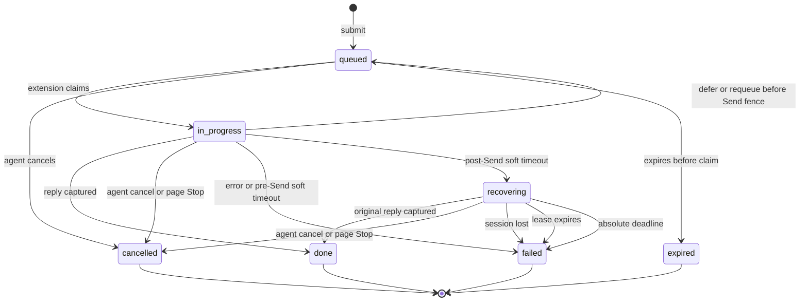

# gpt-relay task lifecycle

This document defines the complete task state machine, including the
soft-deadline recovery state used for long-running ChatGPT replies. The public
HTTP shapes are documented in [`api.md`](./api.md); agent operating rules are in
[`agent-instructions.md`](./agent-instructions.md).

## Design invariants

Session creation is independent of the first task's lifecycle. A stable ref is allocated together with a durable creation command and first queued task. The extension records an open fence before opening a tab, correlates that owned page with its ref, and binds its conversation ID without moving the task queue. Once bound, the session remains created even if its first task fails. Before binding, uncertain open or Send evidence is reported as unknown rather than automatically replayed. Pending successor messages cannot execute until binding. Browser-owned refs remain unchanged during the initial URL transition; unrelated Project or conversation navigation blocks dispatch.

1. A prompt is never automatically replayed after the durable `send_attempted`
   fence. Missing or ambiguous page evidence is not proof that submission
   failed.
2. Each session has at most one active task. Both `in_progress` and
   `recovering` occupy that slot, so a queued successor cannot be attributed to
   the previous reply.
3. Passing the normal task lifetime is not itself a terminal failure after Send.
   The task becomes `recovering` and can still complete normally.
4. Recovery is bounded by both a renewable short lease and an absolute deadline.
5. Explicit cancellation is terminal `cancelled`. Infrastructure or evidence
   loss is terminal `failed` with a machine-readable reason.
6. A client wait timeout never changes server task state.
7. Provisional progress is ephemeral observability only. It cannot change task
   state, renew recovery, or become a final reply.

## Dispatch and page capacity

Unified dispatch separates observation from reservation: one watch per backend and extension instance waits at most 20 seconds, then a durable idempotent claim binds the task to an owner, generation, tab and document. Restart reconciliation restores the original claim before further work. A new generation fences old executors; neither a watch timeout nor a lost claim response permits post-Send replay. Capability negotiation (`capabilities.dispatchV2: true`) selects this path without concurrent legacy claims.

The managed tab limit defaults to 6. Manual pages remain protected unless the user explicitly marks them reclaimable. At capacity, only safe idle reclaimable pages may be closed by least recent activity and parked for later reopening. Queued/active work, drafts, generation, controls or changed activity prevent reclamation; unavailable capacity leaves work waiting. Automatic close gates claims until it finishes and preserves user suspension. Explicit Close retains its durable suspension behavior. See [dispatch details](docs/dispatch.md).

## State diagram



`queued`, `in_progress`, and `recovering` are non-terminal. `done`, `failed`,
`cancelled`, and `expired` are terminal.

## State meanings and transitions

| State | Session slot | Normal exits |
|---|---|---|
| `queued` | No | claim to `in_progress`; cancel to `cancelled`; deadline to `expired` |
| `in_progress` | Yes | reply to `done`; pre-Send defer to `queued`; post-Send soft deadline to `recovering`; cancel/error to terminal state |
| `recovering` | Yes | original reply to `done`; explicit cancel to `cancelled`; lease, session, or absolute timeout to `failed` |
| `done` | No | None; `reply` is final output |
| `failed` | No | None; an eligible late observation may populate `lateReply` without changing status |
| `cancelled` | No | None |
| `expired` | No | None |

The durable Send fence is `sendAttemptedAt`. Before it exists, the extension can
safely defer or requeue a task that never reached ChatGPT. After it exists,
automatic replay is prohibited because the original request may already be
present or generating.

The task status and submission state answer different questions. While a task
is `in_progress` or `recovering`, `submissionState` progresses independently:

| Submission state | Meaning |
|---|---|
| `not_attempted` | No durable Send fence exists |
| `verifying` | Send may have occurred; the extension is inside the fixed two-minute verification window |
| `acknowledged` | A submitted user message or active generation was observed |
| `replied` | A normal or eligible late reply was captured |
| `not_observed` | Verification ended on a fully observed idle page with recorded composer residue |
| `unknown` | Verification ended without enough evidence for either conclusion |

Before each dispatch, the content script makes a bounded best-effort attempt to
remove stale text and attachments. Prompt injection selects the existing
composer contents so text is replaced rather than appended. Cleanup failure is
reported for diagnostics but does not block a later dispatch if Send can still
proceed.

Large pasted text can become an attachment before the Send fence. Ordinary text
waits up to 15 seconds for Send to enable; an attachment path waits up to 90
seconds. An upload timeout or explicit upload error terminates the current task
before Send. The extension then makes another bounded cleanup attempt; failure
to prove a clean composer does not pause the session or automatically replay the
failed task.

## Deadline model

For a task submitted at `submittedAt`:

```text
expiresAt = submittedAt + timeoutMs
completionDeadlineAt = expiresAt + activeTaskGraceMs
recoveryDeadlineAt = completionDeadlineAt + lateReplyGraceMs
recoveryLeaseDeadlineAt = min(lastStrongObservation + recoveryLeaseMs,
                              recoveryDeadlineAt)
```

With default configuration, the task lifetime is 30 minutes, active-task grace
is 1 minute, the recovery lease is 3 minutes, and the absolute recovery grace is
30 minutes. A continuously observed task can therefore remain non-terminal for
about 61 minutes from submission. Raising the normal 30-minute lifetime is not
required for occasional long ChatGPT Pro reasoning; the bounded recovery state
handles it without making every stalled task wait longer.

The transition at `completionDeadlineAt` depends on the Send fence:

- no `sendAttemptedAt`: `in_progress` becomes `failed` with
  `task_processing_timeout` because there is no submitted page request to
  recover;
- `sendAttemptedAt` exists: `in_progress` becomes `recovering`;
- no acknowledgement or generation evidence after Send: recovery reason is
  `delivery_uncertain`;
- acknowledgement or generation was observed: recovery reason is
  `task_deadline_exceeded`.

## Recovery evidence and lease

The extension renews the lease only when the hydrated page supplies strong
evidence tied to the original task:

- ChatGPT is actively generating; or
- the exact submitted user message is visible and its assistant reply has not
  appeared yet.

While that evidence remains visible after the soft deadline, the extension
reports `recovery_observed` at a bounded cadence. The server updates
`recoveryObservedAt`, and `recoveryLeaseDeadlineAt` moves forward without ever
passing `recoveryDeadlineAt`.

These signals are deliberately insufficient on their own:

- a generic session heartbeat;
- a page that is still loading or hydrating history;
- an empty or ambiguous DOM;
- the mere presence of a queued successor.

If strong evidence disappears and is not restored before the lease deadline,
the task becomes `failed` with `task_recovery_lease_expired`. If the absolute
deadline arrives first, it becomes `failed` with `task_recovery_timeout`.
Before those longer recovery limits matter, an unacknowledged Send fence uses a
fixed two-minute verification window. `submission_not_observed` is the explicit
negative result; genuinely ambiguous delivery uses `submission_outcome_unknown`.

## Provisional progress observations

While an active page request is accepted or generating, the extension can
publish a bounded progress snapshot containing a coarse phase, an optional
visible activity label, output character count, and observation/change
timestamps. No partial reply text is sent. Semantic changes are rate-limited to
one report per 10 seconds; unchanged liveness is reported at most once per 30
seconds.

The server holds only the latest snapshot in memory. It is never stored in
SQLite, expires after two minutes without observation, is cleared on a terminal
transition, and may disappear during a server restart. If the page remains
active, a later extension observation recreates it.

Progress and recovery evidence are deliberately separate. A progress snapshot
can help an agent choose its next observation interval, but it does not renew a
recovery lease, prove delivery, make partial output actionable, or alter any
state transition. `reply` remains the only successful final result.

## Session disappearance and cancellation

The browser extension heartbeat proves that the ChatGPT session is still
attached to the relay. If it remains stale for
`GPT_RELAY_HEARTBEAT_STALE_MS`—60 seconds by default—an `in_progress` or
`recovering` task becomes `failed` with `session_heartbeat_lost`. Closing the
tab, browser, or extension therefore releases the session after a short grace
instead of keeping queued work blocked indefinitely.

When the page user selects Stop, the extension calls the user-stop transition.
When an agent calls `DELETE /v1/tasks/:id`, it calls the same semantic decision.
Both make an active task `cancelled`; they are explicit cancellations, not
system failures.

## Queue behavior and submission verification

A recovering task keeps the session exclusive. Active generation and a visible
submitted user message always block queued successors until the original task
finishes or reaches a terminal transition.

After `sendAttemptedAt`, the original task reserves the session for a fixed two
minutes while the extension looks for a submitted message, generation, or a
reply. The presence of newer queued work does not shorten verification. At the
deadline, a fully hydrated `not-started` snapshot plus composer payload observed
at failure time or still present on the page becomes `submission_not_observed`.
Loading, history hydration, tab unavailability, or a clean but ambiguous
composer becomes `submission_outcome_unknown`. The extension clears the old
observer before claiming a successor and never automatically requeues or
resends the prompt.

## Replies after a terminal transition

The normal long-running path is:

```text
in_progress -> recovering -> done
```

The final text is stored in `reply`, and the Agent sees a successful task.

`lateReply` is reserved for a reply discovered after an eligible early terminal
failure, including `submission_not_observed`, `submission_outcome_unknown`, or
session heartbeat loss, while the original absolute recovery window is still
open. Capturing it does not rewrite `failed` to `done`, but `submissionState`
becomes `replied`, so the Agent can use the late result as the effective outcome.
After the absolute deadline, no additional late reply is accepted.

## Agent behavior

An Agent must treat `recovering` as “the original request may still complete”:

- keep the same task ID;
- inspect it with `gpt-relay show <task-id>` or `gpt-relay resume`;
- do not submit the same prompt again;
- cancel explicitly only when the user or workflow wants to abandon it.

During `submissionState: verifying`, keep observing the same task until the
published verification deadline. `acknowledged` means the original submission
was seen and normal reply waiting should continue. `not_observed` is a concrete
send failure; `unknown` is an ambiguity that requires an Agent or human retry
decision. If `lateReply` later appears, prefer it over the earlier operational
failure and do not send another copy.

A `queued`, `in_progress`, or `recovering` response from a long poll is not an
error. Likewise, a CLI client wait timeout only ends that invocation; it does
not authorize a duplicate task.

When `progress` is present, use `changedAt` and `revision` only as scheduling
hints. Continued changes justify a nearer observation; an advancing
`observedAt` without a new revision means the page remains active but visibly
unchanged. Never review, implement, or quote provisional activity as if it were
the final response.

## Deployment and compatibility

The server migrates an existing SQLite `tasks` table on startup to allow the
new status and recovery columns. The public session response retains
`inProgressTaskId` as a compatibility alias while adding `activeTaskId` and
`activeTaskStatus`.

Source edits do not hot-swap a server started with `pnpm start`, and an unpacked
extension does not reload itself. Activate this change during an idle window in
this order:

1. restart the relay server so the schema and API are current;
2. Reload the unpacked extension from `chrome://extensions/`;
3. refresh the affected `chatgpt.com` tabs so their content scripts match.

Updating only one side temporarily leaves it on the old behavior, so avoid a
mixed-version rollout while tasks are active.
