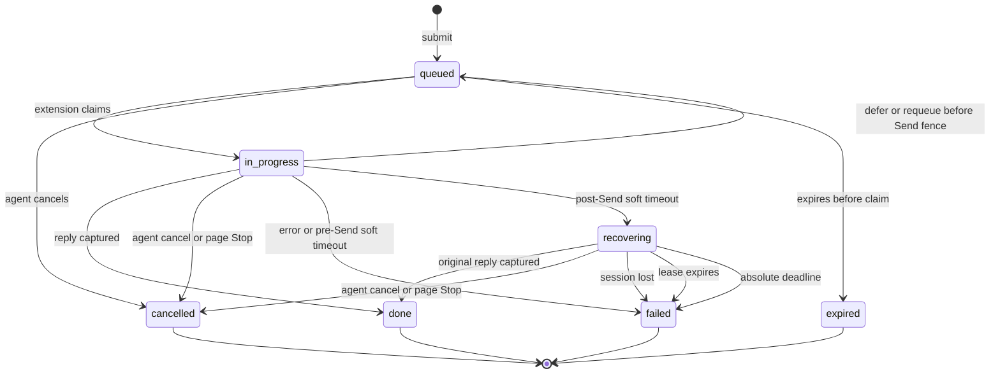

# gpt-relay task lifecycle

This document defines the complete task state machine, including the
soft-deadline recovery state used for long-running ChatGPT replies. The public
HTTP shapes are documented in [`api.md`](./api.md); agent operating rules are in
[`agent-instructions.md`](./agent-instructions.md).

## Design invariants

1. A prompt is never automatically replayed after the durable `send_attempted`
   fence. Missing or ambiguous page evidence is not proof that submission
   failed.
2. Each session has at most one active task. Both `in_progress` and
   `recovering` occupy that slot, so a queued successor cannot be attributed to
   the previous reply.
3. Passing the normal task lifetime is not itself a terminal failure after Send.
   The task becomes `recovering` and can still complete normally.
4. Recovery is bounded by both a renewable short lease and an absolute deadline.
5. Explicit cancellation is terminal `cancelled`. Infrastructure or evidence
   loss is terminal `failed` with a machine-readable reason.
6. A client wait timeout never changes server task state.

## State diagram



`queued`, `in_progress`, and `recovering` are non-terminal. `done`, `failed`,
`cancelled`, and `expired` are terminal.

## State meanings and transitions

| State | Session slot | Normal exits |
|---|---|---|
| `queued` | No | claim to `in_progress`; cancel to `cancelled`; deadline to `expired` |
| `in_progress` | Yes | reply to `done`; pre-Send defer to `queued`; post-Send soft deadline to `recovering`; cancel/error to terminal state |
| `recovering` | Yes | original reply to `done`; explicit cancel to `cancelled`; lease, session, or absolute timeout to `failed` |
| `done` | No | None; `reply` is final output |
| `failed` | No | None; an eligible late observation may populate `lateReply` without changing status |
| `cancelled` | No | None |
| `expired` | No | None |

The durable Send fence is `sendAttemptedAt`. Before it exists, the extension can
safely defer or requeue a task that never reached ChatGPT. After it exists,
automatic replay is prohibited because the original request may already be
present or generating.

## Deadline model

For a task submitted at `submittedAt`:

```text
expiresAt = submittedAt + timeoutMs
completionDeadlineAt = expiresAt + activeTaskGraceMs
recoveryDeadlineAt = completionDeadlineAt + lateReplyGraceMs
recoveryLeaseDeadlineAt = min(lastStrongObservation + recoveryLeaseMs,
                              recoveryDeadlineAt)
```

With default configuration, the task lifetime is 30 minutes, active-task grace
is 1 minute, the recovery lease is 3 minutes, and the absolute recovery grace is
30 minutes. A continuously observed task can therefore remain non-terminal for
about 61 minutes from submission. Raising the normal 30-minute lifetime is not
required for occasional long ChatGPT Pro reasoning; the bounded recovery state
handles it without making every stalled task wait longer.

The transition at `completionDeadlineAt` depends on the Send fence:

- no `sendAttemptedAt`: `in_progress` becomes `failed` with
  `task_processing_timeout` because there is no submitted page request to
  recover;
- `sendAttemptedAt` exists: `in_progress` becomes `recovering`;
- no acknowledgement or generation evidence after Send: recovery reason is
  `delivery_uncertain`;
- acknowledgement or generation was observed: recovery reason is
  `task_deadline_exceeded`.

## Recovery evidence and lease

The extension renews the lease only when the hydrated page supplies strong
evidence tied to the original task:

- ChatGPT is actively generating; or
- the exact submitted user message is visible and its assistant reply has not
  appeared yet.

While that evidence remains visible after the soft deadline, the extension
reports `recovery_observed` at a bounded cadence. The server updates
`recoveryObservedAt`, and `recoveryLeaseDeadlineAt` moves forward without ever
passing `recoveryDeadlineAt`.

These signals are deliberately insufficient on their own:

- a generic session heartbeat;
- a page that is still loading or hydrating history;
- an empty or ambiguous DOM;
- the mere presence of a queued successor.

If strong evidence disappears and is not restored before the lease deadline,
the task becomes `failed` with `task_recovery_lease_expired`. If the absolute
deadline arrives first, it becomes `failed` with `task_recovery_timeout`.
Genuinely unconfirmed delivery uses `submission_outcome_unknown`.

## Session disappearance and cancellation

The browser extension heartbeat proves that the ChatGPT session is still
attached to the relay. If it remains stale for
`GPT_RELAY_HEARTBEAT_STALE_MS`—60 seconds by default—an `in_progress` or
`recovering` task becomes `failed` with `session_heartbeat_lost`. Closing the
tab, browser, or extension therefore releases the session after a short grace
instead of keeping queued work blocked indefinitely.

When the page user selects Stop, the extension calls the user-stop transition.
When an agent calls `DELETE /v1/tasks/:id`, it calls the same semantic decision.
Both make an active task `cancelled`; they are explicit cancellations, not
system failures.

## Queue behavior and uncertain delivery

A recovering task keeps the session exclusive. Active generation and a visible
submitted user message always block queued successors until the original task
finishes or reaches a terminal transition.

For a delivery-uncertain record, a fully hydrated and stably idle page can prove
that there is no visible submitted request. When newer work is queued, the
extension may end that ambiguous observation as `submission_outcome_unknown`
and release the queue. It clears the old observer before claiming the successor
and never requeues or resends the uncertain prompt.

## Replies after a terminal transition

The normal long-running path is:

```text
in_progress -> recovering -> done
```

The final text is stored in `reply`, and the Agent sees a successful task.

`lateReply` is reserved for a reply discovered after an eligible early terminal
failure, such as session heartbeat loss, while the original absolute recovery
window is still open. Capturing it does not rewrite `failed` to `done`. After the
absolute deadline, no additional late reply is accepted.

## Agent behavior

An Agent must treat `recovering` as “the original request may still complete”:

- keep the same task ID;
- inspect it with `gpt-relay show <task-id>` or `gpt-relay resume`;
- do not submit the same prompt again;
- cancel explicitly only when the user or workflow wants to abandon it.

A `queued`, `in_progress`, or `recovering` response from a long poll is not an
error. Likewise, a CLI client wait timeout only ends that invocation; it does
not authorize a duplicate task.

## Deployment and compatibility

The server migrates an existing SQLite `tasks` table on startup to allow the
new status and recovery columns. The public session response retains
`inProgressTaskId` as a compatibility alias while adding `activeTaskId` and
`activeTaskStatus`.

Source edits do not hot-swap a server started with `npm start`, and an unpacked
extension does not reload itself. Activate this change during an idle window in
this order:

1. restart the relay server so the schema and API are current;
2. Reload the unpacked extension from `chrome://extensions/`;
3. refresh the affected `chatgpt.com` tabs so their content scripts match.

Updating only one side temporarily leaves it on the old behavior, so avoid a
mixed-version rollout while tasks are active.
